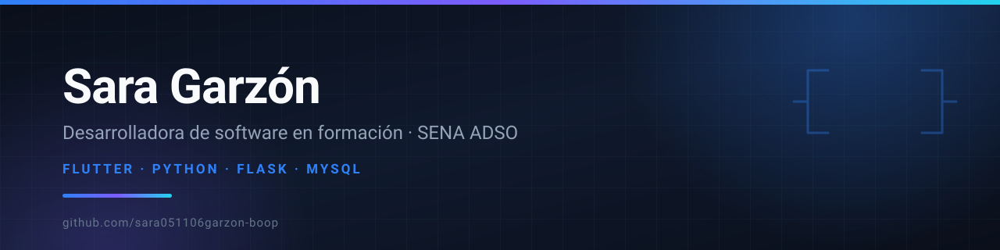

<div align="center">
  
</div>

<div align="center">

# 👋 Hola, soy Sara Garzón

**Construyendo productos digitales de principio a fin**

Construyo aplicaciones con **Flutter** en el front-end y **Python / Flask** en el back-end,
con pruebas automatizadas y flujo de trabajo en equipo sobre Git.

<br/>

[](https://github.com/sara051106garzon-boop)
[](https://www.linkedin.com/in/sara-yeilyn-garz%C3%B3n-81a11734a)
[](mailto:sara051106garzon@gmail.com)
[](https://www.instagram.com/_saraaaa.g_/)

</div>

---

## 🚀 Sobre mí

**Desarrolladora Full Stack / de Software** enfocada en construir aplicaciones web
y móviles, APIs backend, bases de datos, automatización y despliegue en la nube,
desde el diseño y la lógica hasta producción.

- 🎨 Interfaces web y móviles con **Flutter**.
- ⚙️ Backend y APIs REST con **Python / Flask**.
- 🗄️ Bases de datos relacionales con **MySQL** y **SQLAlchemy**.
- 🐳 Contenedores con **Docker** y despliegue en la nube (**AWS EC2**, **Vercel**).
- 🤖 Automatización / RPA y calidad de software con **pytest** y **CI/CD**.
- 🌱 Aprendiendo buenas prácticas de arquitectura, testing y trabajo colaborativo con Git.
- 📍 Bogotá, Colombia.

---

## 🚗 ParkLink — proyecto estrella

Sistema completo de gestión de parqueaderos para **Redeban**: control de acceso,
celdas, vehículos, usuarios, roles, monitoreo y operación; con autenticación por
JWT y una app conectada a la API.

| Componente | Stack | Repositorio |
| :--- | :--- | :--- |
| **Frontend** | Flutter Web · Vercel | [`parklink-app`](https://github.com/sara051106garzon-boop/parklink-app) |
| **Backend** | Python · Flask · Gunicorn · MySQL | [`parklink-backend`](https://github.com/sara051106garzon-boop/parklink-backend) |

[](https://github.com/sara051106garzon-boop/parklink-backend/actions/workflows/tests.yml)
[](https://github.com/sara051106garzon-boop/parklink-backend/blob/main/.github/workflows/tests.yml)
[](https://parklink-app.vercel.app)

> API REST documentada, 10 pruebas unitarias con pytest y un pipeline en GitHub Actions
> que bloquea el merge a `main` si alguna prueba falla.

### 🏗️ Arquitectura y capacidades clave

```text
🖥️  Flutter Web (Vercel)
      │ https://parklink-app.vercel.app
      │ proxy /api/* (rewrites) → evita Mixed Content y CORS
      ▼
☁️  AWS EC2 — Docker (parklink-production-web)
      │ puerto 8001 → 5000 interno
      ▼
🐍  Gunicorn + Flask (wsgi:app)
      │ JWT · Flask-Bcrypt ($2b$) · SQLAlchemy
      ▼
🗄️  MySQL 8.0 (parklink_production)
```

- **Frontend** en Flutter Web desplegado en Vercel, con proxy inverso `/api/*`
  (`rewrites` en `vercel.json`) hacia el backend para evitar *Mixed Content* y CORS.
- **Backend** en Flask / Gunicorn ejecutándose en AWS EC2 sobre Docker
  (`parklink-production-web`, puerto `8001` → `5000`) conectado a MySQL 8.0, con
  autenticación segura con Flask-Bcrypt (`$2b$`).
- Gestión de vehículos, celdas, accesos, roles, reportes, pruebas y flujos de
  despliegue continuo.

---

## 🛠️ Stack tecnológico

**Lenguajes**

[](https://dart.dev/)
[](https://www.python.org/)
[](https://developer.mozilla.org/es/docs/Web/JavaScript)
[](https://www.java.com/)

**Frontend**

[](https://flutter.dev/)
[](https://developer.mozilla.org/es/docs/Web/HTML)
[](https://developer.mozilla.org/es/docs/Web/CSS)

**Backend**

[](https://flask.palletsprojects.com/)
[](https://www.sqlalchemy.org/)
[](https://gunicorn.org/)

**Bases de datos**

[](https://www.mysql.com/)

**Cloud & DevOps**

[](https://aws.amazon.com/ec2/)
[](https://www.docker.com/)
[](https://vercel.com/)
[](https://github.com/features/actions)
[](https://git-scm.com/)

**Herramientas / QA / Automatización**

[](https://pytest.org/)

---

## 🎓 Formación

**FORMACIÓN ACADÉMICA**

- **Tecnólogo en Análisis y Desarrollo de Software** — Servicio Nacional de Aprendizaje (SENA) · Bogotá
  *Cursando · Egreso previsto: julio 2027 · Etapa productiva: enero 2027*
  - Formación en análisis, diseño y desarrollo de software, con programación orientada a objetos (Java) y bases de datos relacionales.
  - Metodologías de desarrollo y aseguramiento de la calidad del software.
  - Etapa productiva (práctica empresarial) en búsqueda activa de empresa patrocinadora registrada ante el SENA Bogotá.
- **Técnico en Programación de Software** — Servicio Nacional de Aprendizaje (SENA) · Bogotá
  *Graduada: diciembre 2024*
  - Desarrollo de software con Python, JavaScript y SQL aplicados a soluciones reales.
  - Creación y maquetación de páginas web con HTML5, CSS3 y JavaScript en Visual Studio Code.
  - Manejo de bases de datos relacionales, consultas SQL y principios de programación orientada a objetos.
- **Bachillerato Académico** — Colegio Gabriel Betancourt Mejía · Bogotá
  *Graduada: diciembre 2024*

**CERTIFICACIONES**

- **English Does Work — Niveles 1, 2 y 3** · SENA (2025)
- **Inmersión en Inteligencia Artificial en la Práctica** · Daxus (octubre 2026)

---

## 📂 Otros proyectos

| Proyecto | Descripción | Stack |
| :--- | :--- | :--- |
| [`world-cup-database`](https://github.com/sara051106garzon-boop/world-cup-database) | Base de datos relacional de los mundiales: esquema, carga desde CSV y consultas de análisis | SQL · PostgreSQL · Bash |
| [`practica-sqlalchemy`](https://github.com/sara051106garzon-boop/practica-sqlalchemy) | Modelado de datos con SQLAlchemy y migraciones de Alembic | Python · SQLAlchemy |
| [`practica-sqlalchemy-roles`](https://github.com/sara051106garzon-boop/practica-sqlalchemy-roles) | Modelos relacionales: usuarios, roles, canciones y álbumes | Python · SQLAlchemy |
| [`rutas-sara`](https://github.com/sara051106garzon-boop/rutas-sara) | Rutas, controladores y modelos del back-end de ParkLink | Python · Flask |
| [`parklink-backend-v1`](https://github.com/sara051106garzon-boop/parklink-backend-v1) | Primera versión del back-end de ParkLink | Python · Flask |

---

## 🐍 Contribuciones

<div align="center">

<picture>
  <source media="(prefers-color-scheme: dark)" srcset="https://raw.githubusercontent.com/sara051106garzon-boop/sara051106garzon-boop/output/snake-dark.svg" />
  <source media="(prefers-color-scheme: light)" srcset="https://raw.githubusercontent.com/sara051106garzon-boop/sara051106garzon-boop/output/snake.svg" />
  
</picture>

</div>

## 📊 GitHub

<div align="center">

[](https://github.com/sara051106garzon-boop?tab=followers)


<br/>

<picture>
  <source media="(prefers-color-scheme: dark)" srcset="https://github-readme-stats.vercel.app/api?username=sara051106garzon-boop&show_icons=true&hide_border=true&bg_color=1f2328&title_color=2f81f7&text_color=c9d1d9&icon_color=2f81f7" />
  <source media="(prefers-color-scheme: light)" srcset="https://github-readme-stats.vercel.app/api?username=sara051106garzon-boop&show_icons=true&hide_border=true&bg_color=ffffff&title_color=2f81f7&text_color=1f2328&icon_color=2f81f7" />
  
</picture>

<picture>
  <source media="(prefers-color-scheme: dark)" srcset="https://github-readme-stats.vercel.app/api/top-langs/?username=sara051106garzon-boop&layout=compact&hide_border=true&bg_color=1f2328&title_color=2f81f7&text_color=c9d1d9" />
  <source media="(prefers-color-scheme: light)" srcset="https://github-readme-stats.vercel.app/api/top-langs/?username=sara051106garzon-boop&layout=compact&hide_border=true&bg_color=ffffff&title_color=2f81f7&text_color=1f2328" />
  
</picture>

</div>

---

<div align="center">

## 🤝 Contacto

[](https://github.com/sara051106garzon-boop)
[](https://www.linkedin.com/in/sara-yeilyn-garz%C3%B3n-81a11734a)
[](mailto:sara051106garzon@gmail.com)
[](https://www.instagram.com/_saraaaa.g_/)

<sub>Abierta a prácticas, proyectos colaborativos y oportunidades de aprendizaje.</sub>

</div>
