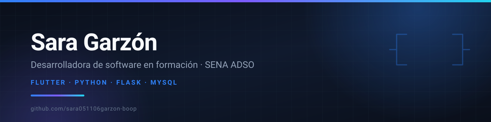

  

Construyo aplicaciones con **Flutter** en el front-end y **Python / Flask** en el back-end,
con pruebas automatizadas y flujo de trabajo en equipo sobre Git.

 

---

## Sobre mí

- 🎓 Estudiante de **ADSO** (Análisis y Desarrollo de Software) en el SENA.
- 🚗 Desarrollando **ParkLink**, un sistema de gestión de parqueaderos con app móvil y API REST.
- 🧪 Me interesa el código que se puede probar: pytest, GitHub Actions y ramas protegidas.
- 🌱 Aprendiendo buenas prácticas de arquitectura, testing y trabajo colaborativo con Git.
- 📍 Colombia.

---

## Proyecto destacado

### 🚗 ParkLink — gestión de parqueaderos

Sistema completo para administrar entrada y salida de vehículos, cupos, tarifas y
usuarios, con autenticación por JWT y una app móvil conectada a la API.

| Módulo | Stack | Repositorio |
| :--- | :--- | :--- |
| **Back-end** | Python · Flask · SQLAlchemy · JWT · MySQL · pytest | [`parklink-backend`](https://github.com/sara051106garzon-boop/parklink-backend) |
| **App móvil** | Dart · Flutter | [`parklink-app`](https://github.com/sara051106garzon-boop/parklink-app) |

> API REST documentada, 10 pruebas unitarias con pytest y un pipeline en GitHub Actions
> que bloquea el merge a `main` si alguna prueba falla.

---

## Otros proyectos

| Proyecto | Descripción | Stack |
| :--- | :--- | :--- |
| [`world-cup-database`](https://github.com/sara051106garzon-boop/world-cup-database) | Base de datos relacional de los mundiales: esquema, carga desde CSV y consultas de análisis | SQL · PostgreSQL · Bash |
| [`practica-sqlalchemy`](https://github.com/sara051106garzon-boop/practica-sqlalchemy) | Modelado de datos con SQLAlchemy y migraciones de Alembic | Python · SQLAlchemy |
| [`practica-sqlalchemy-roles`](https://github.com/sara051106garzon-boop/practica-sqlalchemy-roles) | Modelos relacionales: usuarios, roles, canciones y álbumes | Python · SQLAlchemy |
| [`rutas-sara`](https://github.com/sara051106garzon-boop/rutas-sara) | Rutas, controladores y modelos del back-end de ParkLink | Python · Flask |
| [`parklink-backend-v1`](https://github.com/sara051106garzon-boop/parklink-backend-v1) | Primera versión del back-end de ParkLink | Python · Flask |

---

## Contribuciones

<picture>
  <source media="(prefers-color-scheme: dark)" srcset="https://raw.githubusercontent.com/sara051106garzon-boop/sara051106garzon-boop/output/snake-dark.svg" />
  <source media="(prefers-color-scheme: light)" srcset="https://raw.githubusercontent.com/sara051106garzon-boop/sara051106garzon-boop/output/snake.svg" />
  
</picture>

## Actividad

---

### Contacto

Abierta a prácticas, proyectos colaborativos y oportunidades de aprendizaje.

